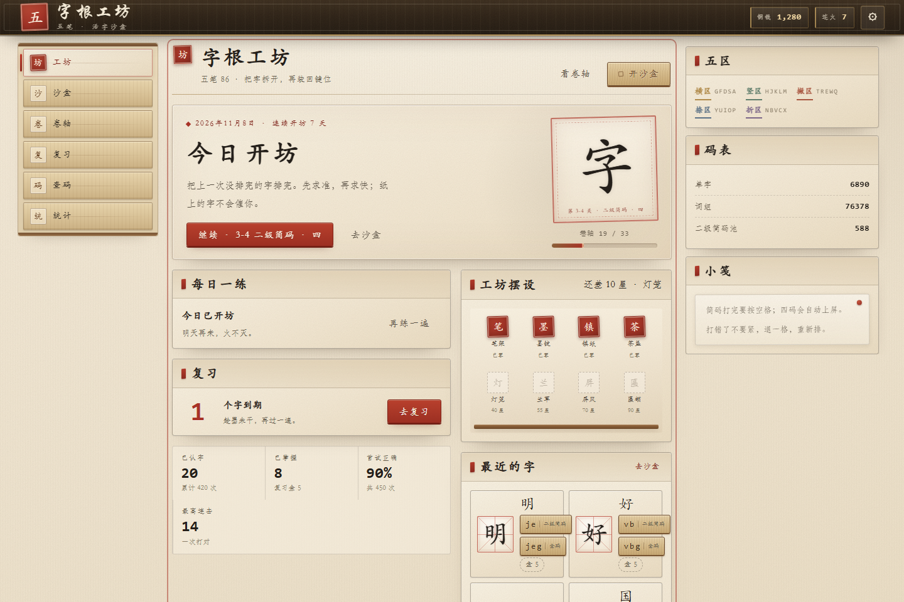
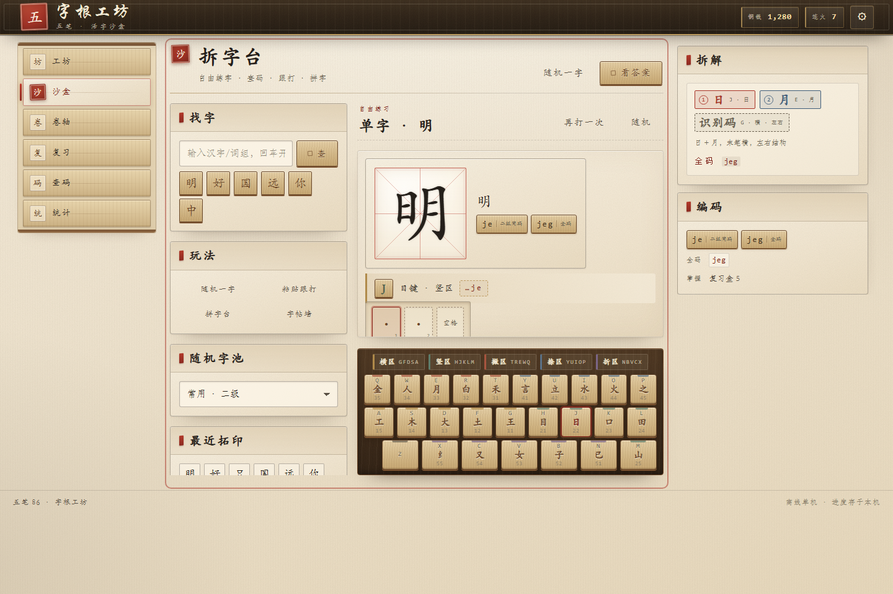
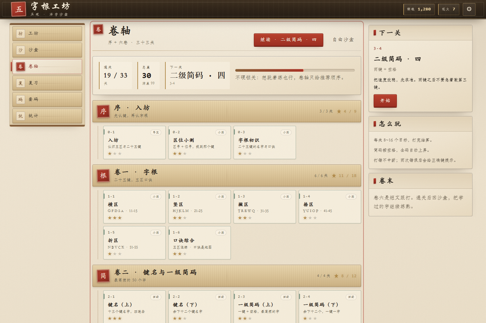

# 字根工坊 · 五笔 86 学习沙盒

把五笔学习做成一间「活字印刷工坊」：25 个键是活字盘，拆字是排版，打对编码就是拓印成字。
自由沙盒随时玩，33 关卷轴带着学。完全离线、零依赖、双击即开。

## 预览

| 工坊首页 | 拆字台（沙盒） | 卷轴 |
| --- | --- | --- |
|  |  |  |

## 快速开始

1. 用 Edge / Chrome 打开本目录的 `index.html`（`file://` 即可，不需要服务器）。
2. 第一次进入会显示三步导览；也可以从「设置 → 重看开坊导览」再看。
3. 推荐顺序：序卷 → 一（字根）→ 二（键名/一级简码）→ 三（二级简码）→ 四（三级/全码/识别码）→ 五（词组）→ 六（跟打）。

> 练习时请把输入法切到英文（Shift）。游戏自己判定编码，不需要安装五笔输入法；查字/粘贴框仍可使用中文输入法。

## 内容

- **33 关，序 + 六卷**：
  - 序：五区二十五键、区位小测、键名口诀
  - 一：五区字根 → 键
  - 二：25 键名字、25 一级简码（空格上屏）
  - 三：二级简码（599 个可选池）
  - 四：三级简码、全码、末笔识别码（15 格矩阵）
  - 五：二字/三字/四字/多字词组
  - 六：三篇 50~80 字跟打短文
- **沙盒**：查字、随机一字、整段跟打、拼字、字帖墙；显示简码/全码、逐键字根域、精选拆解；拆解按第 1~4 个字根分色编号。
- **查码**：按字查、按码查（重码）、二十五键图鉴。
- **复习**：SRS 盒子（10 分钟 / 1 天 / 3 天 / 7 天 / 21 天），每日一练。
- **养成**：XP、连击、星级、8 件工坊摆设、10 个成就、12 周热力图。

## 数据

- 字库来自本机微软五笔 86 词库 `C:\WINDOWS\InputMethod\CHS\ChsWubi.lex`，由 `tools/build_data.py` 离线解析：
  - 87,514 条记录，6,890 个单字，76,378 个词组
  - 单字编码长度分布：1 码 25、2 码 599、3 码 4,411、4 码 6,044
- 生成物：`data/wubi86-chars.js`、`data/wubi86-words.js`、`data/build-report.json`。
- 不采用 `ChsWubiNew.lex`：它与 86 base 存在全码差异，容易教错。
- 拆分词库仅用于个人本地学习；若要公开发布，请替换为有明确许可的开源代码表（例如 Rime 五笔 86）。

重新生成（可选）：

```powershell
python tools/build_data.py --src "C:\WINDOWS\InputMethod\CHS" --out data
```

## 开发与测试

零构建、零 npm 依赖；脚本按 `index.html` 中的顺序以经典 `<script>` 加载。

```powershell
# 数据/引擎/关卡/复习/拆解测试
node --test --test-isolation=none tests/data.test.js tests/decomp.test.js tests/engine.test.js tests/levels.test.js tests/progress.test.js
```

测试在受限沙箱里若报 `spawn EPERM`，用上面的 `--test-isolation=none`；普通环境可直接 `node --test tests/`。

## 目录

```
index.html            应用外壳与脚本加载顺序
css/                  设计令牌、基础、组件、屏幕、动效
data/                 生成的码表（勿手改）
js/core/              dict / levels / progress / engine / audio / util
js/data/              roots / lessons / decompositions / passages
js/ui/                各屏幕组件
js/app.js             启动、hash 路由、demo 状态
tools/build_data.py   码表解析与校验
tests/                node:test
qa/                   测试报告与本地截图（不入库）
docs/screenshots/     README 预览图
```

## 浏览器与字体

- 目标：最新版 Edge / Chrome，桌面 1280 以上体验最佳，960 以下自动堆叠。
- 字体使用系统自带：`STXingkai`（标题）、`STKaiti`（界面标题/字卡）、`STFangsong`（正文）、`Consolas`（编码）；缺失时回退到楷体/宋体。
- 所有视觉资源（纸纹、木纹、印章、音效）均为 CSS/SVG/WebAudio 内联生成，无外部请求。

## 已知限制

- 只做五笔 86；98/新世纪不在本版。
- 拆解仅覆盖 120 个精选字，其余字提供「逐键字根域」提示，不假装完整拆解。
- 单机单用户，进度存在浏览器 `localStorage`（键名 `zg.v1`）；换浏览器/清缓存会丢失，可在设置中导出/导入 JSON。
- 触屏可浏览，但练习按物理键盘设计。
